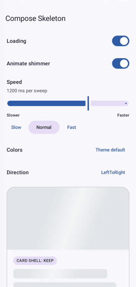

# Compose Skeleton

[](https://central.sonatype.com/artifact/io.github.manug243/compose-skeleton)
[](https://github.com/manug243/compose-skeleton/actions/workflows/ci.yml)

A lightweight Compose Multiplatform library for layout-aware skeleton placeholders with a synchronized shimmer effect.

The skeleton uses the size already measured by Compose. You keep building the real component and add `Modifier.skeleton()` where you would add a background. One `SkeletonHost` coordinates the loading state and shimmer across all participating children.


## Try it

The `example` app lets you play with the library: toggle loading, switch shimmer on and off, change speed, colors and direction, and compare `Keep`, `Shimmer` and `Solid` on a real card.



```bash
./gradlew :example:installDebug
```

## Installation

Compose Skeleton is a Compose Multiplatform library. Supported targets: Android (`minSdk 24`), Desktop (JVM), iOS (`iosArm64`, `iosSimulatorArm64`) and Web (`wasmJs`, `js`). The code lives entirely in `commonMain`, so it uses only common Compose APIs.

Releases are published to Maven Central from Git tags (`v1.0.0-rc1`).

```kotlin
// shared/build.gradle.kts
kotlin {
    sourceSets {
        commonMain.dependencies {
            implementation("io.github.manug243:compose-skeleton:1.0.0-rc1")
        }
    }
}
```

Android-only projects can use the same coordinate in `dependencies { implementation(...) }`.

## Compatibility

| Compose Skeleton | Kotlin | Compose Multiplatform | Android `minSdk` |
| --- | --- | --- | --- |
| `1.0.0-rc1` | 2.3.21 | 1.12.2 | 24 |

The versions are the ones the library is built with. Your project needs at least these, because Compose `ui` is an `api` dependency and Kotlin/Native and Web artifacts require a compiler at least as new as the one that produced them.

## Status

`1.0.0-rc1` is a release candidate. The API is meant to be final and is tracked with Kotlin's ABI validation (`skeleton/api`); it only changes before `1.0.0` if feedback on the release candidate requires it. See the [changelog](CHANGELOG.md) for the changes since `0.1.0`.

## Modules

| Module | Purpose |
| --- | --- |
| `skeleton` | Reusable Compose library |
| `example` | Interactive Android example app |

## Usage

```kotlin
SkeletonHost(enabled = loading) {
    OutlinedCard(
        modifier = Modifier.skeleton(SkeletonMode.Keep),
    ) {
        Box(
            modifier = Modifier
                .fillMaxWidth()
                .height(180.dp)
                .skeleton(SkeletonMode.Shimmer),
        )

        Text(
            text = title,
            modifier = Modifier
                .fillMaxWidth(0.8f)
                .skeleton(SkeletonMode.Solid),
        )
    }
}
```

`Modifier.skeleton()` does not change measurement. Use `width`, `height`, `size`, `fillMaxWidth`, and other layout modifiers to define the placeholder dimensions. Outside a `SkeletonHost`, the modifier is a no-op.

## Modes

| Mode | Loading behavior | Interactive while loading |
| --- | --- | --- |
| `Shimmer` | Replaces content with the shared animated gradient | No |
| `Solid` | Replaces content with the base placeholder color | No |
| `Keep` | Draws the real content, useful for card shells, borders, and status labels | Yes |
| `Hide` | Draws nothing while preserving layout space | No |

`SkeletonMode` is a value class with constants, not an enum, so modes can be added later without breaking existing code. Add an `else` branch when you match on it with `when`.

A multiline `Text` is represented by one rectangle. Use separate `Text` composables when each line should have its own width or mode.

## Interaction while loading

A placeholder should not react like the real component. While the host is enabled, every element that is not in `Keep` mode:

- is hidden from accessibility services,
- blocks presses on itself and its children, so `clickable`, `toggleable` and tap gestures do not fire,
- cannot gain keyboard focus.

Drags are not blocked, so a list can still be scrolled from a placeholder. `Keep` elements stay fully interactive.

Place `.skeleton()` **before** `clickable` and `focusable` in the modifier chain. A modifier cannot fully control modifiers that come before it: with `clickable { }.skeleton()` presses are still blocked, but keyboard focus is not. Components such as `Button(modifier = Modifier.skeleton())` apply your modifier first and work as expected. The KDoc of `Modifier.skeleton()` lists the remaining limitations (hover effects, padding between `clickable` and `.skeleton()`, minimum touch targets).

## Styling

```kotlin
val style = SkeletonDefaults.style(
    baseColor = Color(0xFFE2E5E9),
    highlightColor = Color(0xFFF7F8FA),
    shape = RoundedCornerShape(10.dp),
    animationDurationMillis = 1_000,
    highlightWidth = 140.dp,
    tiltDegrees = 18f,
    direction = SkeletonDirection.LeftToRight,
)

SkeletonHost(
    enabled = loading,
    animationEnabled = animationsAllowed,
    style = style,
) {
    Content()
}
```

The default colors adapt to the system light or dark theme. If your app has its own theme switch, pass it with `SkeletonDefaults.style(darkTheme = isAppInDarkTheme)`. To style every host in the app once, provide a style in your theme; a `SkeletonHost` without an explicit `style` picks it up:

```kotlin
CompositionLocalProvider(
    LocalSkeletonStyle provides SkeletonDefaults.style(darkTheme = isAppInDarkTheme),
) {
    App()
}
```

Setting `animationEnabled` to `false` renders shimmer elements as solid placeholders. Skeleton content is removed from accessibility semantics while loading, except for elements using `Keep`.

`animationDurationMillis` is the time for one complete shimmer sweep. Lower values move faster. Updating a duration while loading restarts the sweep; updating colors keeps its current position. In the example app, the speed slider runs from slower on the left to faster on the right.

Use `baseColor` for every solid placeholder and the outside of the shimmer, and `highlightColor` for the bright band. Pass `Color.Unspecified` to `SkeletonDefaults.style()` to retain its theme-aware color. Individual elements can override both colors while sharing the host animation:

```kotlin
Box(
    modifier = Modifier
        .size(72.dp)
        .skeleton(
            colors = SkeletonColors(
                baseColor = Color(0xFF263238),
                highlightColor = Color(0xFF80CBC4),
            ),
        ),
)
```

## Build

```shell
./gradlew :skeleton:desktopTest :skeleton:testAndroidHostTest :skeleton:lint
./gradlew :skeleton:jsTest :skeleton:wasmJsTest
./gradlew :skeleton:checkKotlinAbi
./gradlew :example:assembleDebug :example:lintDebug
```

The project requires JDK 21 and Android SDK platform 37. The web tests need a local Chrome. The iOS tests (`./gradlew :skeleton:iosSimulatorArm64Test`) can only be run on macOS. After an intended public API change, run `./gradlew :skeleton:updateKotlinAbi` and commit the updated files in `skeleton/api`.

## Contributing

Bug reports, ideas and pull requests are welcome. See [CONTRIBUTING.md](CONTRIBUTING.md) before opening a pull request, and use [Discussions](https://github.com/manug243/compose-skeleton/discussions) for questions.

## License

Compose Skeleton is available under the Apache License 2.0. See [LICENSE](LICENSE).
